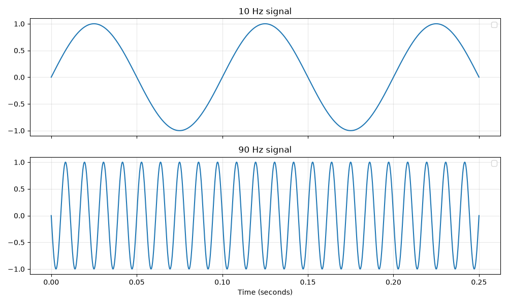
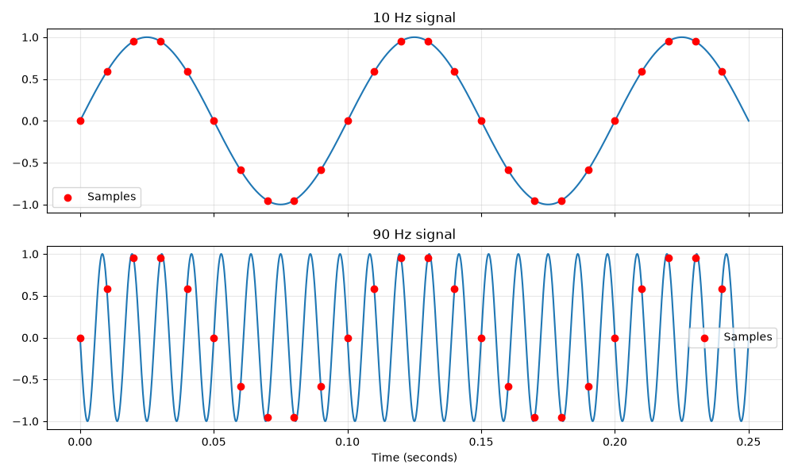
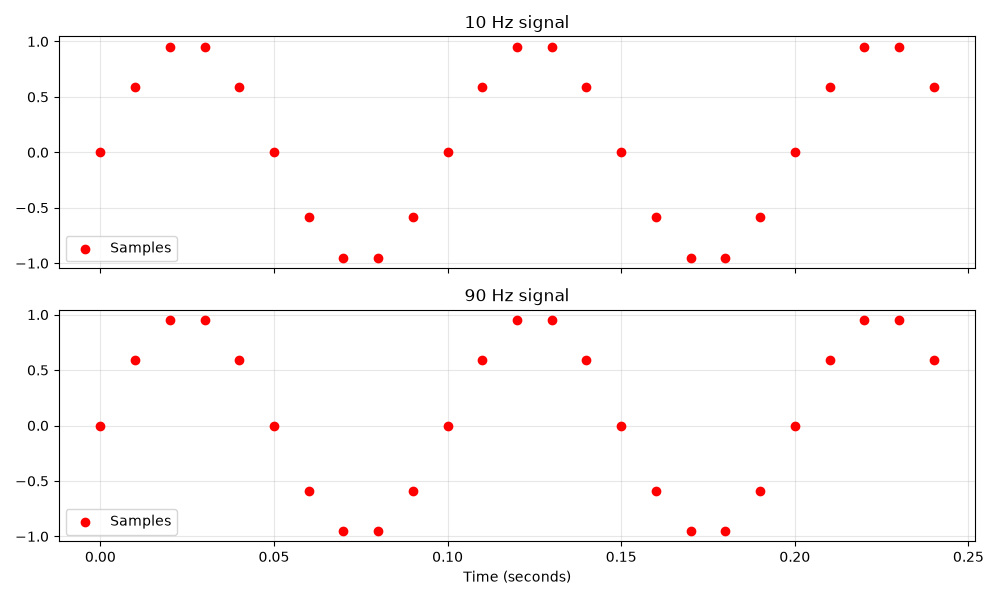
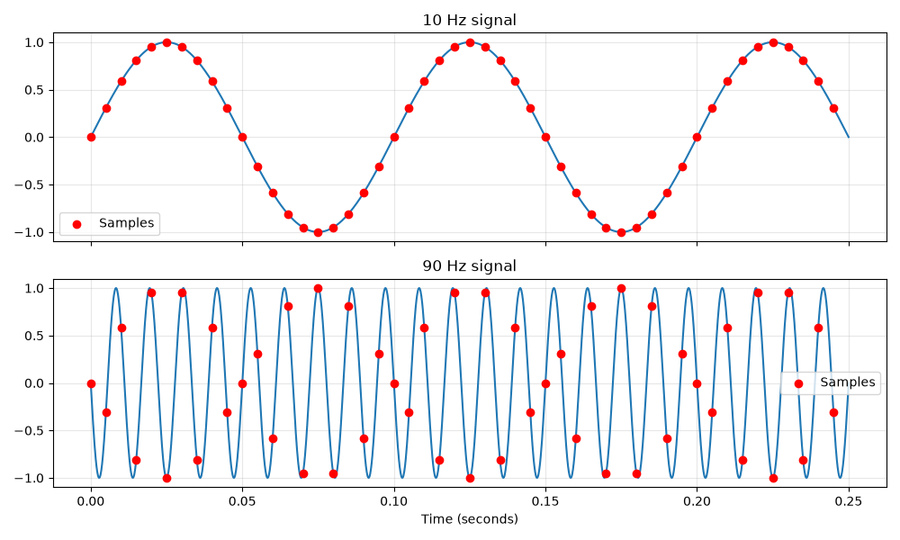
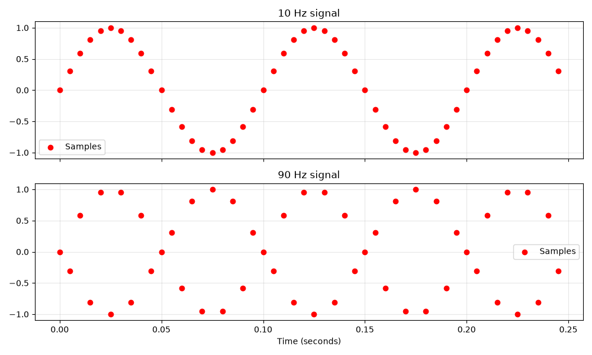

If you grew up around CDs, you might have wondered at some point "How on earth does a shiny plastic disc store music?" If you were anything like me, you probably googled for answers and came to a conclusion similar to this: 

!!! note ""
    CDs store data using a single long spiral track of microscopic bumps and flat spaces called pits and lands, which represent binary code (1s and 0s) read by a laser beam.

This answer satisfied me as a kid (even though it's technically incomplete), but as I grew older so did the questions.

- "How is audio, i.e. pressure waves, converted into a series of 1s and 0s?"
- "How exactly does a laser beam 'read' a pit or a land?"
- "If the pits and lands are microscopic, how does a considerably scratched or smudged disc still read well?"
- "How does the laser maintain alignment with the microscopic spiral track?"

If you've ever had these questions yourself, I'm pleased to report that this set of articles will be of help. If not, consider reading them anyway because CDs utilize some amazing technology under the hood. Let's start with the basics.

## Encoding Digital Audio (PCM)

CDs store audio as a long list of numbers. The numbers are in binary of course, but in the end they form a giant list that you could write down on paper. How do we convert audio into numbers? You've probably heard that what we perceive as 'sound' is our brain responding to changes in the local air pressure that causes our eardrums to vibrate. Using a microphone, we can measure these changes in air pressure at a particular spot. The microphone has a diaphragm similar to our ear, which when vibrated generates electricity, with larger diaphragm displacements producing more voltage. If we record these voltages over time, we can essentially 'store' audio. 

Let's perform a thought experiment. We attach the microphone to a voltmeter and write down the perceived loudness every second. A microphone's diaphragm produces no voltage at its resting position, and a positive or negative voltage as it vibrates back and forth. Since different microphones can produce different voltages for the same loudness, we create an arbitrary "amplitude" scale. A value of '0' represents the diaphragm's resting position, while -100 & 100 denote the peak amplitudes, i.e. the maximum positive and negative voltages the diaphragm can produce. This process of chopping up an analog signal into discrete time intervals is called **sampling**, and converting the analog voltages at each sample point into discrete values is called **quantization**. After half a minute of "recording", we end up with the list below.

```
-37, 84, -91, 15, 100, -62, 7, -48, 73, -100, 29, -14, 56, -79, 98, 0, -33, 67, -88, 41, -5, 92, -71, 13, -96, 58, -22, 100, -49, 36, -81
```

We now hook a speaker up to a variable power supply, and adjust the voltage according to these values every second. The speaker's diaphragm will move back and forth as the voltage changes, producing pressure waves. But there's a problem. Since we're only changing the voltage every second, the speaker would only receive one new amplitude every second, so it couldn't reproduce rapidly changing sound waves. Humans have a hearing range of (ideally) 20 Hz to 20,000 Hz. So we need to sample audio at least 20,000 times a second to capture the entire hearing range, right? Not quite. This is where the **Nyquist-Shannon sampling theorem** comes in. It says that to reconstruct an analog signal from discrete samples (the numbers we've noted down), the sampling rate should be at least twice the highest frequency we want to reproduce. Since we want our setup to record frequencies till 20 kHz to capture all audible sound, we need a sampling frequency (also called the **sample rate**) of at least 40 kHz. Let me try to provide an intuitive explanation of why this is the case.

Consider the scenario below, showing two sine waves oscillating at 10 Hz and 90 Hz. I've taken a 0.25 second slice of the waveform, meaning the 10 Hz wave has completed 2.5 cycles.



We're going to sample both these waves 100 times per second. Since the vertical grid lines are 0.05 seconds apart, we'll have 5 samples after each grid line. Our sampling frequency of 100 Hz is higher than both the waves. But if the Nyquist-Shannon theorem holds true, the maximum frequency we can safely sample is 50 Hz. Let's try sampling. I've marked the sample points for both waves with red dots.



You might have already noticed that we have a problem. Let me make it clearer by removing the original wave, so we only see the sample points.



The samples for the 10 Hz and 90 Hz waves are identical! If we were to record the 90 Hz wave and play it back, it would sound like a 10 Hz wave. This is called aliasing - an audio distortion where higher frequencies masquerade as lower frequencies due to an insufficient sampling frequency. Let's perform the sampling again, this time with a sampling frequency of 200 Hz, as suggested by the theorem.



And once more with the sine waves removed.



Aliasing is also the reason analog audio recordings needs to be pre-processed before any sampling can be done. The original signal is first fed through a low-pass filter to remove all frequencies above the Nyquist limit (which was 50 Hz in our example), ensuring that they don't cause weird audio artifacts after sampling.

So we understand the effect sample rate has on recorded audio. In our example, we measured the voltage at each sample point as a value between -100 and 100. The number of discrete values available to record amplitude (200 in our case) is called the **resolution**, as it determines how well the recorder can "resolve" small changes in amplitude. Higher resolution gives you more **dynamic range**, allowing you to capture minor changes in volume more clearly. This means if you have an especially quiet recording, you can boost the gain without amplifying noise caused by quantization, allowing you to preserve more detail.

Audio CDs follow a specification called the Red Book audio standard, which specifies the resolution as 16 bits (-32768 to 32767) and the sample rate as 44.1 kHz. There's an interesting historical reason as to why the sample rate is this weirdly specific number, which I have explained in the collapsible block below.

??? info "Why is CD audio sampled at 44.1 kHz?"
    Pulse Code Modulation was developed long before CDs and was used in professional digital recorders since the 1970s. These recorders used video cassette tapes as they were the only medium which could hold a substatial amount of data at the time. At the time, analog television had two major standards - NTSC (North America & Japan) and PAL (Europe, Australia, India). These standards dictated the refresh rate (60 Hz for NTSC and 50 Hz for PAL) and the number of scan lines drawn each frame (525 vs 625). But the video signal was interlaced (each frame was drawn using only even or odd scan lines, i.e. half of the total), so there were 245 (NTSC) or 294 (PAL) **active** scan lines for each interlaced field excluding the blanking intervals. The reason I'm throwing these numbers at you is that engineers were looking for a way to have digital audio recordings to sound exactly the same on NTSC and PAL systems. This required storing an integral (i.e. an integer) number of audio samples per scan line, so they could synchronise audio playback to a reference and reuse existing circuitry to simplify the process. By storing a modest three samples per scan line, they could calculate the following sample rates:

    ```math
    \text{NTSC: } 245_{\text{lines}} \times 60_{\text{fields/sec}} \times 3_{\text{samples/line}} = 44,100 \text{ Hz}
    ```
    
    ```math
    \text{PAL: } 294_{\text{lines}} \times 50_{\text{fields/sec}} \times 3_{\text{samples/line}} = 44,100 \text{ Hz}
    ```
    
    The sample rate was thus locked to the video sync frequencies and the tape would always move at the correct speed.  But there was another advantage to having the sample rate slightly higher than required. Remember when I said all frequencies above the Nyquist limit need to be cut off to prevent aliasing? A perfect "brick-wall" filter that instantly drops from 100% volume at 20 kHz to 0% volume at 20.001 kHz isn't practically feasible, and can cause severe phase distortion as you get near 20 kHz. Having the sample rate set to 44.1 kHz pushes the Nyquist limit up to 22.05 kHz, giving the analog filters a safe ramp to fade out the ultrasonic frequencies without muddying the music.

The final step now is to encode (convert) our numeric list of samples into binary numbers. For CDs, each value is stored as a 16-bit binary 'word'. Negative values are stored using two's complement. These four steps (low-pass filtering, sampling, quantization, encoding) collectively form a technique called Pulse Code Modulation (PCM) - the method used to convert analog audio into a binary bit stream that can be stored on any digital medium, including a CD.

In the [next part](compact-disc-2.html), we'll explore how a CD player actually reads data from what looks like a plain shiny surface.

<!-- Click here to read the next part, where we explore... -->
