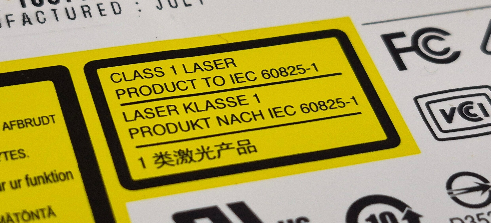
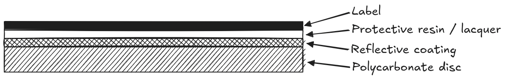
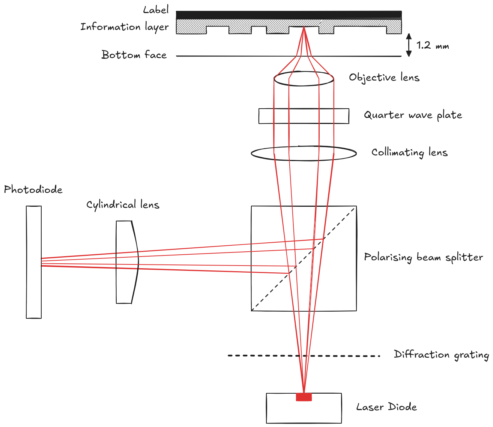

In the [previous article](compact-disc-1.html), we saw how an audio signal is converted into a stream of binary digits using a technique called Pulse Code Modulation. However there are a few more operations that need to be performed on this bit stream before the data can be written to a disc. To understand why these operations are required, we first need to know how data is actually read from a CD, which is the topic of this article.

If you've looked closely at a CD player, you might have seen this sticker on it.



It's a pretty well known fact that CDs, DVDs and other optical media use laser light to read information from a disc. The light is emitted from a laser assembly that sits beneath the spinning disc, and gets reflected off the shiny disc surface and into a photodiode (light detector). Selected regions of the shiny side are 'modified' to reduce the amount of light that reaches the photodiode, so when the disc is spinning the photodiode sees flickering light. This flicker is interpreted as a sequence of 1s and 0s, which can be reassembled into the original data. With this basic overview out of the way, let's get into the details.

!!! warning "Resist the temptation"
    After reading about all the interesting stuff that happens inside a CD player, you might be tempted to open one up to see a live demonstration. DO NOT DO THIS! As we'll soon see, CD drives use an infrared laser which is invisible to human eyes, but can still damage your retina if you inadvertently look directly at it (and you won't even know to blink).

The CD itself is usually made out of polycarbonate. The official specification doesn't specify the material, however it insists that the refractive index is 1.55 (we'll see why later). The disc has a label on top, and a reflective coating just underneath it, protected from oxidation from a thin layer of plastic resin or lacquer.

{: .img-noborder}

The CDs we are concerned with use microscopic pits etched into the polycarbonate surface to reduce the amount of light that reaches the photodiode. These pits are stamped on the side containing the label, so the **information layer** as it's called is sandwiched between the label and the polycarbonate disc. The pits form a single continuous track that starts at the center of the disc spiralling outward. The pits and the untouched areas between successive pits called 'lands' are what encode the 1s and 0s stored on a disc. It's common to assume that the pits and lands themselves carry some semantic meaning, like pits representing a '1' and lands representing a '0'. But retrieving information stored this way would be extremely unreliable. It's true that a land reflects more light than a pit, but to know whether the laser is currently over a pit or a land would require measuring the amount of reflected light, which isn't easily quantifiable or consistent. Dust, smudges or even slight imperfections in the disc surface (which are unavoidable during manufacturing) can alter the absolute brightness of reflected light, so using raw light intensity isn't feasible. It's much easier to detect a *change* in the brightness level, or the *transition* between a pit and a land.

Any transition (**pit to land** or **land to pit**) is recorded as a '1', while no transition is recorded as a '0'. At this point you might be wondering how the periods of no transition are measured accurately. If the player sees `LAND -> LONG PIT -> LAND` how can it accurately know how many zeros made up the pit? We'll get to that later. But first, how exactly do these microscopic pits alter the amount of light reaching the sensor?

## The Optical Pickup Mechanism

Below is a simplified diagram showing a typical CD player laser assembly. The actual design and the orientation of some components can vary according to the manufacturer and space restrictions, but this diagram is good enough for us.

{: .img-noborder}

The optical pickup mechanism houses a laser light source which emits a monochromatic (containing a single frequency) light beam. CDs are designed to be read by a laser with a wavelength of 780 nanometers. The light passes through a diffraction grating (which we'll ignore for now) and then through a beam splitter. Laser light is polarised, meaning the electromagnetic field that it's composed of doesn't change direction. For a better understanding of polarisation, read the block below. The beam splitter is designed to allow light oscillating in this direction to pass straight through, and deflect polarised light vibrating in a perpendicular direction. The light continues on through a collimating lens that converts the divergent light rays into a parallel beam. Next it passes through a quarter wave plate, which converts the linearly polarised light into circularly polarised light, before being focused on the information layer by an objective lens.

Since the pits and lands are 1.2 mm beneath the surface, the laser beam is still relatively broad as it passes through the polycarbonate surface. Small scratches or imperfections will be out of focus and allow enough light to pass through to the information layer. After hitting a pit or a land, it reflects back through the objective lens. When the circularly polarised light passes through the quarter wave plate, it gets converted back to linear polarisation, but rotated by 90 degrees from the incident light. As a result, the beam splitter deflects the beam sideways, so it ends up shining on the photodiode assembly. The incident and reflected beams having different polarisation also ensures that they don't obstruct each other while travelling along the same path. The deflected light then passes through a cylindrical lens (which we'll also ignore for now) before finally ending up at the photodiode.

??? info "Polarisation in more detail"
    Light is an electromagnetic wave, meaning it consists of oscillating electric and magnetic fields travelling through space. For standard unpolarized light (like sunlight), the electric field vibrates in every conceivable direction perpendicular to the direction of travel. Linear polarization occurs when all the light waves in a beam vibrate along a single plane. Most laser diodes naturally emit linearly polarized light, which you can visualise like a rope being shaken up and down through a narrow vertical fence. There are two main types of polarization that are used in the CD pickup:

    1. **Linear Polarization:** Light vibrates strictly in one orientation (e.g., purely horizontal or purely vertical). The polarizing beam splitter acts like a selective gateway—it lets light of one linear orientation pass straight through, but reflects light vibrating perpendicular to it sideways.
    2. **Circular Polarization:** As light travels forward, its plane of vibration continuously rotates in a corkscrew pattern (either clockwise or counter-clockwise). 

    When linearly polarized light passes through the quarter wave plate, it converts the linear beam into a corkscrewing, circularly polarized beam. When this circular light hits the CD's reflective layer and bounces back, its corkscrew direction flips (much like how your left and right hands swap in a mirror image). When this reversed circular light passes back through the quarter-wave plate on its return journey, it gets converted back into linearly polarized light—but now rotated by 90 degrees relative to where it started.

Things get interesting when the beam hits a pit. With a width of 0.5 micrometers (roughly 1/100th the width of a human hair), the pit is narrower than the beam even after being focused by the objective lens (around 2 micrometers), so the beam spills out over the edges on both sides (which is not a bug, it's a feature). The depth of each pit is engineered to be around 110-125 nanometers. When the 780 nm laser light passes through the polycarbonate disc, its wavelength changes since it enters a much denser medium. We can calculate its wavelength inside the polycarbonate disc using the following formula. In our case, $`\lambda_1`$ is 780 nm, and $`n`$ (refractive index of polycarbonate) is 1.55. Thus we arrive at the following result.

```math
\lambda_2 = \frac{\lambda_1}{n} = \frac{780\ nm}{1.55} \approx 503.23\ nm
```

You might have noticed that the pit depth is about a quarter of the wavelength of the beam. This is intentional. The central part of the beam travels into the pit, gets reflected and comes out of the pit. The extra distance the light has to travel due to the pit (quarter the wavelength twice) shifts the phase of this light by half its wavelength. When this phase-shifted light combines with the light reflected from around the pit which isn't phase-shifted, it destructively interferes with itself, dropping the intensity of the overall beam. If you aren't familiar with the concept of interference, read the block below.

??? info "What is interference?"
    If you have two speakers playing the same song, it will sound louder than just one speaker playing it. Waves (sound is a wave) exhibit a property called "interference", meaning multiple waves can combine to produce a resulting wave with a higher or lower "energy" (amplitude) depending on how the peaks and troughs of the original waves align. In this case, the sound waves from the two speakers **constructively interfere** with each other, adding up to produce a resulting wave with twice the amplitude. If you instead phase-shift one of the waves by 180 degrees such that the peak of one wave lines up with the trough of another, the waves will **destructively interfere** and cancel each other out. This is how noise-cancelling headphones work. Light exhibits a similar behaviour, where the interaction of two light sources can produce a lighter or darker resulting beam depending on the phase difference between the two sources.

This diminished beam makes it back to the photodiode, which can register the drop in light intensity. The signal from the photodiode is still analog, and there are a few more operations that need to be done on this signal before any meaningful information can be extracted, which we'll discuss later. But for the most part, this is how a laser beam is able to read 1s and 0s off a shiny disc. At least, in theory. There are several assumptions we're currenty making for this process to work:

- Every single land and pit is clearly visible to the laser (not even the slightest smudge or speck of dust)
- The laser is always focused precisely on the disc surface (absolutely no disc wobble allowed)
- The spiral track is perfectly centered around the disc's spindle (too bad if the hole is even slightly off-center)
- The disc's rotation speed is maintained with impeccable accuracy (to accurately track how many zeroes have passed since the last pit or land)

This is of course completely impractical, so as I mentioned in the beginning, several transformations need to be made to the PCM audio data before it can be translated into a sequence of pits and lands. That is the topic of the next article, so stay tuned!
