I recently found a revived interest in a Casio CTK-810IN electronic keyboard I have had since childhood. The keyboard has an SD card slot where you can save and play back MIDI files. This is something that has interested me since childhood, since MIDI files sound much better on the keyboard using high quality samples than on my computer with its basic soundfont.

But there's a catch. You need a special piece of software called the [Casio SMF Converter](https://music.casio.com/e/smf/) to convert the `.mid` file used by computers to a format compatible with the keyboard. This program is extremely old and only available for Windows. As a programming exercise, I decided to attempt to reverse engineer the file format to create my own cross-platform SMF converter. However I have no prior experience with this kind of stuff, so I decided to start with something simpler. My keyboard happens to use another proprietary format, so I decided to tackle that one first.

This is the story of how I reverse-engineered Casio's `.CR5` file format used for storing registration memory setups for the CTK-810 IN. Perhaps this might serve as a guide for anyone wanting to do something similar in the future (or me in case I forget what I did).

## What is a 'Registration Memory Setup'?

The CTK-810IN keyboard has a feature called 'Registration' which can be used to save and recall configurations at the press of a button. For example, if you're playing a song where you need to switch between three different instruments with different reverb settings, it's too difficult to change the settings while playing. The keyboard allows you to create preset configurations of settings like the tone, rhythm, tempo, pedal settings, etc. and save them to an internal registration memory, which you can recall at any time by pressing one of the four buttons. This makes it easy to switch between configurations while playing. The keyboard has 8 registration 'banks', each with 4 'setups', for a total of 32 different configurations.

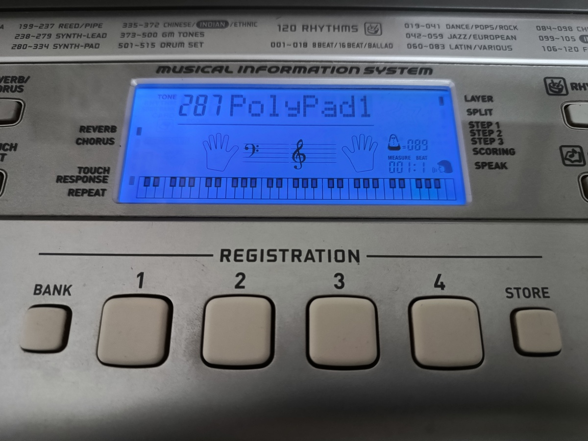

Additionally, if you have an SD card inserted into the keyboard, you can save the entire registration memory containing 32 setups to a file on the card (and you can have 999 such files on the card at any time!).

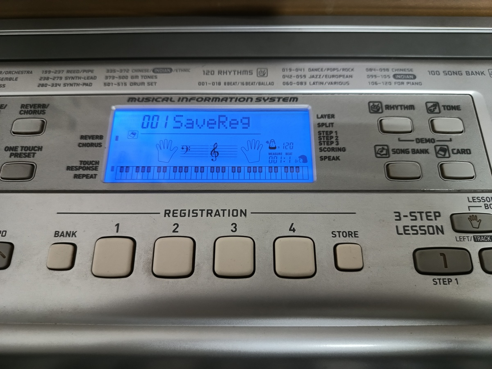

The file is in a proprietary format with a `.CR5` extension. It's a binary format, so you can't open it in a text editor and obtain any meaningful information about its contents.

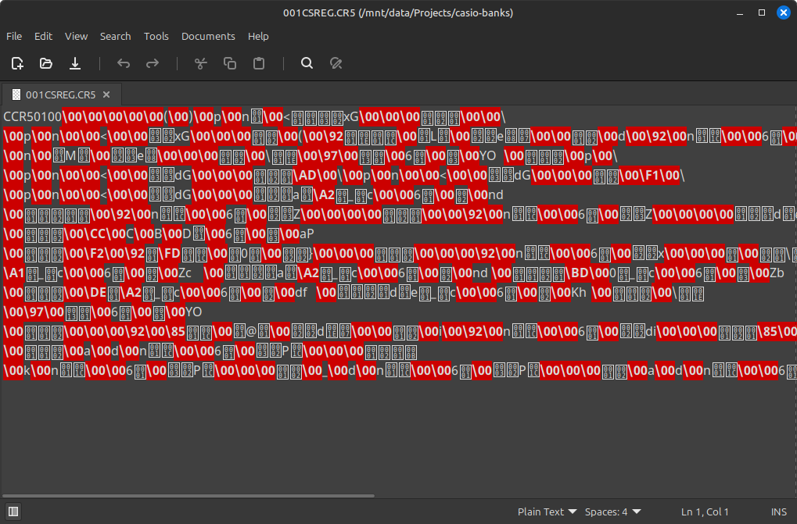

I decided that my goal was to first decipher this format and be able to print out all the stored data in a human-readable format, and then be able to edit the data and store it back into the file, which can be read by the keyboard.


## Initial Steps

Given that I was working with a binary format, I first ran it through `file`[^1] to check if it was perhaps derived from some other documented file format.

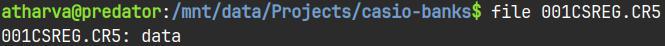

That didn't help, so I dumped its contents using `xxd`.

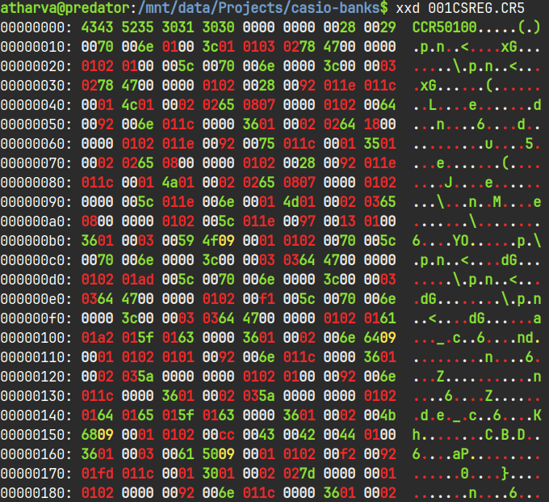

??? note "What exactly am I looking at?"
    `xxd` is a program used to generate a 'hexdump' - a representation of a binary file where all its bits are listed as hexadecimal (base 16) numbers.The first like starts at address 0, i.e. the first byte of the file. Each group of four characters represents two bytes (1234 represents 12 as the first byte and 34 as the second). Each row has 8 groups (meaning 16 bytes per line). The leftmost column shows the address of the first byte in that line, and the increment by 10 hex (16 in decimal) bytes. The area on the right shows an [ASCII](https://en.wikipedia.org/wiki/ASCII) representation of each byte. Bytes which don't have a printable ASCII character are represented with a `.` symbol.

The hexdump didn't make it much more readable than before, however I could see some bytes at the very beginning which in ASCII spelled out `CCR50100`. This seemed to be the file signature for this format[^2]. The keyboard most likely checks the signature before loading any data from the file.

There was no point in staring at the meaningless bytes that followed, so I went back to the keyboard to create a **baseline** file. The keyboard has a default configuration which is set every time you turn it on. I copied this default configuration across all setups and banks. Then I saved it to a file on the SD card. Since this file contained 32 identical configurations, I could expect to see 32 repeating byte patterns in the hexdump. This would allow me to pinpoint where in the file these configurations were stored, hopefully the number of bytes allocated to each configuration.

I ran the file through `xxd` again.

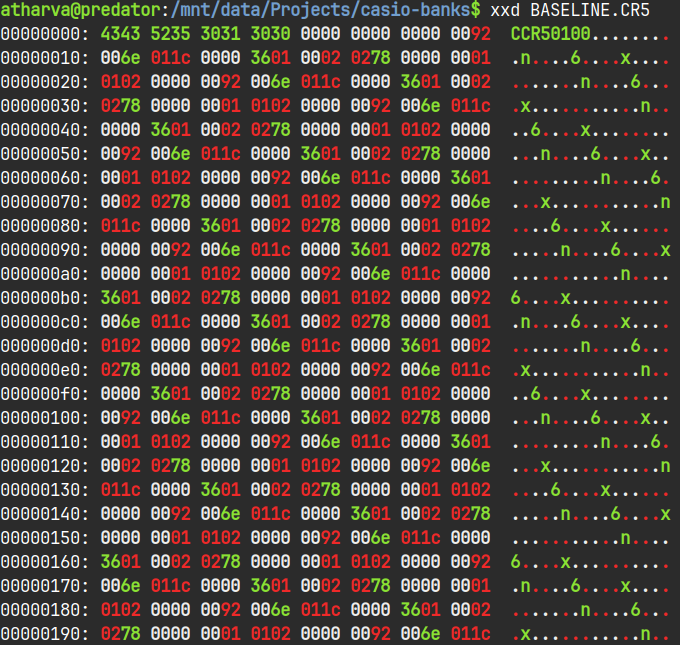

You can clearly see a repeating pattern in the file, especially if you look at the ASCII representation on the right. Comparing this hexdump to the earlier one, I could see that four bytes after the file signature were 0 in both versions. I decided to assume that the actual registration data was stored from byte 13 of the file.

After staring at the file for a while, I realized that each one of the 32 setups occupied exactly 22 bytes in memory. It wasn't a hard thing to figure out, since I just had to find repeating patterns within the bytes. My claim was further verified when I calculated the file size based on my assumptions. 32 setups * 22 bytes each + 12 bytes for the header gives a total of 716 bytes, which is exactly the size of each `.CR5` file!

## A Better Output Format

Now that I knew how the file was structured, I needed to figure out what each of the 22 bytes was responsible for, and my plan was to use *differential analysis* to perform this task. Essentially, I had already created a 'baseline' file containing the default settings. I would now create another file, where in each registration setup, I would change only a single setting and document what I had changed. By comparing both files, I could pinpoint which of the 22 bytes stored which setting and in which format.

But first, I needed a better way of printing out the file contents. I started by modifying the `xxd` command like so:

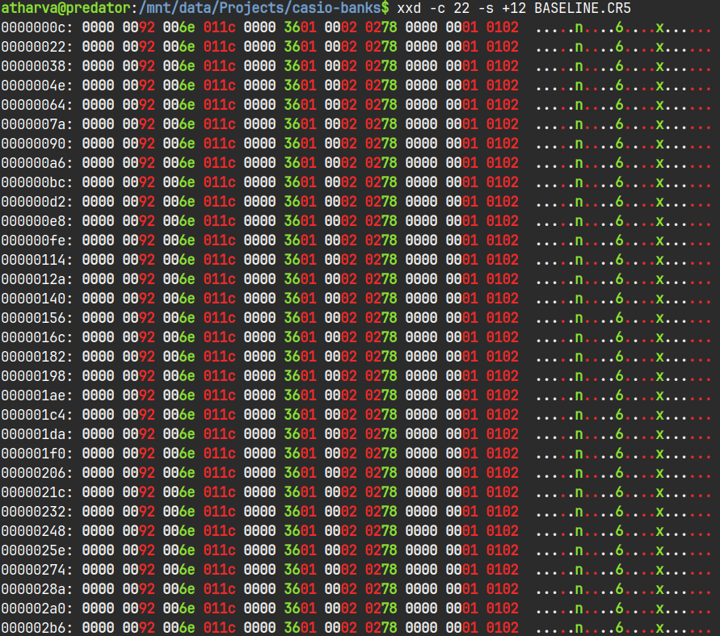

The `-c 22` flag sets the columns per line to 22 (the size of each setup), and `-s +12) tells it to start printing 12 bytes from the start (so we skip the header).

This was much better, however since I was planning to implement parsing and modifying this file anyway, I hacked together a Python script that did basically the same thing. I decided to change the output formatting a bit - I omitted the addresses at the beginning of each line, printed the data in one-byte groups, and replaced the ASCII representation with a decimal representation, since the file stored settings like the tone number & tempo which could just be stored as integers.

```python
FILE_SIGNATURE = b'CCR50100'

# Returns a list of bytes starting at a specified offset
def read_bytes(stream, offset, length):
    return stream[offset:offset+length]

def main():
    filename = input("Enter filename (without extension): ")

    # Read file contents
    with open(f"{filename}.CR5", "rb") as file:
        bank_file = file.read()

    # Verify that we're working with a valid CR5 file
    signature = read_bytes(bank_file, 0, 8)
    if signature == FILE_SIGNATURE:
        print("File signature verified. Continuing...")
    else:
        print(f"Invalid file signature! Expected CCR50100, found {signature}. Exiting...")
        return

    # Print saved data
    for bank in range(8):
        print(f"Bank {bank}:")
        for setup in range(4):
            save = read_bytes(bank_file, (12 + ((bank*4)+setup) * 22), 22)
            for j in range(0, 22):
                print(f"{save[j]:02x}", end=" ")
            print("   |   ", end="")
            for j in range(0, 22):
                print(f"{save[j]}", end=" ")
            print()

if __name__ == "__main__":
    main()
```

And this is how the output looked:

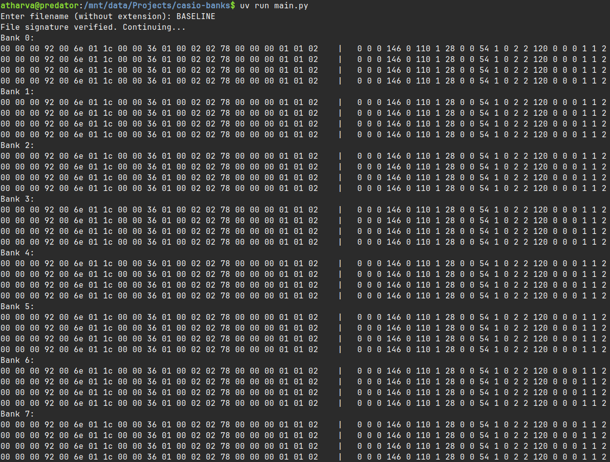

On the left are the 22 bytes in hex, grouped into banks. On the right are the same bytes represented as unsigned integers.

## Differential Analysis

I first made a note of which settings were actually saved in the registration setups. The user manual makes this very clear.

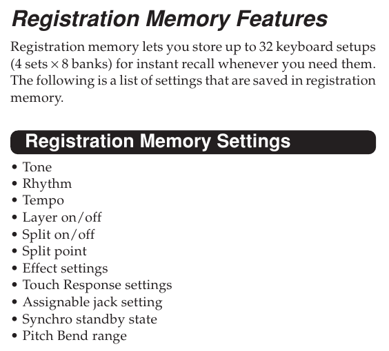

I won't go into detail of how I deduced the location of each setting within the file, since it gets pretty repetitive. I would just tweak a single setting multiple times, and watch how the 22 bytes reacted to the change. It kind of felt like solving a Sodoku puzzle, where everything seems unconnected at first, but the more you solve the easier it gets.

Some settings like the tempo and pitch bend, are stored as is, so spotting them in the bytewise integer representation was extremely easy. Others like the standby state (whether a rhythm starts playing when you play a note) and the pedal configuration have arbitrary values associated to each option, so I cycled through each possible option and noted the value assigned to that option. I also made a few interesting discoveries along the way.

The CTK810-IN has 515 tones, so the file needs two bytes to represent the tone number (1 byte can hold a maximum value of 255). Interestingly, the keyboard uses big endian[^3] notation to store this value (high order byte has the lower address), so the number 484 (or 1E4 in hexadecimal) is stored in memory as `01 E4`. This sounds reasonable, but it is in contrast to modern computers & smartphones which use little endian notation, so the same value would be stored as `E4 01`.

Another interesting thing is how the touch response[^4] setting is saved. The keyboard has 3 touch response settings. I expected this to be stored as a single byte with three possible values, however it's instead stored across two bytes as follows:

| Bye 19 | Byte 20 |  Touch Response |
|:------:|:-------:|:---------------:|
|    0   |    1    |    0 (Off)    |
|    1   |    1    | 1 (On, default) |
|    1   |    0    |  2 (On, strong) |

If you're interested, the diagram below shows what each of the 22 bytes is responsible for.

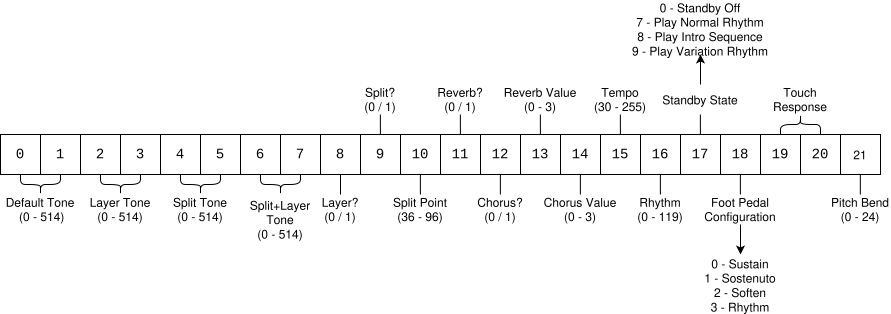

With this, I had finally reverse-engineered the `.CR5` file format. Now it was time to parse the file and display all this data in a readable fashion.

## Parsing

I decided to expand on my simple Python script to make a decent terminal-based program which can view and edit the registration files. I decided to use the [Rich](https://github.com/Textualize/rich) library which makes adding fancy stuff like tables and coloured text in the terminal really convenient. I won't dump the the entire script here, but I go through some of it below.

I used Python's dataclasses to create a custom structure to store each registration data.

```python
@dataclass(repr=False)
class setup_class:
    tone_default: int
    tone_layer: int
    tone_split: int
    tone_split_layer: int
    layer: bool
    ...
```

I wrote a `to_bytes()` method for the dataclass which converts my custom object into the 22 byte array which the keyboard can read, using the built-in `to_bytes` function for the `int` class.

```python
def to_bytes(self):
    data = bytearray(22)
    data[0:2] = self.tone_default.to_bytes(2, 'big')
    data[2:4] = self.tone_layer.to_bytes(2, 'big')
    data[4:6] = self.tone_split.to_bytes(2, 'big')
    data[6:8] = self.tone_split_layer.to_bytes(2, 'big')
    data[8] = self.layer
    ...
```

I ditched the nested for loop from earlier for a single one which runs 32 times, and populates my custom setups array with each registration setup.

```python
for i in range(32):
    offset = 12 + (i * 22)
    save_data = read_bytes(bank_file, offset, 22)
    setups.append(setup_class(
        read_uint_be(save_data, 0),
        read_uint_be(save_data, 2),
        read_uint_be(save_data, 4),
        read_uint_be(save_data, 6),
        save_data[8],
        save_data[9],
        ...
```

This is also the point where I used AI for some drudge work. Every tone and rhythm on the keyboard has a unique name, but only the number is stored in the setup file (which is to be expected). However I wanted my script to print out the names along with the numbers, so I needed to create huge lists (of 515 items for tones, 120 for rhythms) which I could then index into while printing. As far as I know, Casio doesn't have the tone list on their [website](http://arch.casio-intl.com/asia-mea/en/emi/localized/ctk810in/), only the user manual. Copying text from the Tones table was worthless since the table was rotated sideways, but most LLMs these days can work with images. So it was just a matter of taking a screenshot of the table from the PDF and feeding it to Gemini, which gave me a nicely formatted Python list that I could plop right into a `constants.py` file.

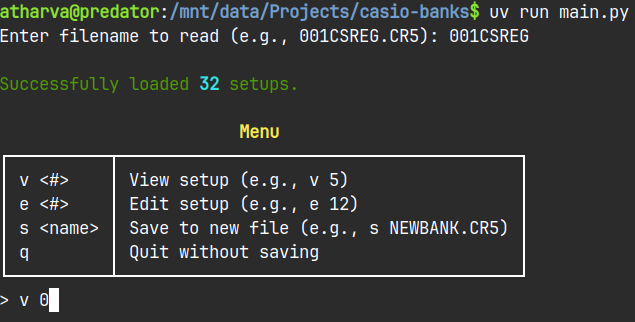  

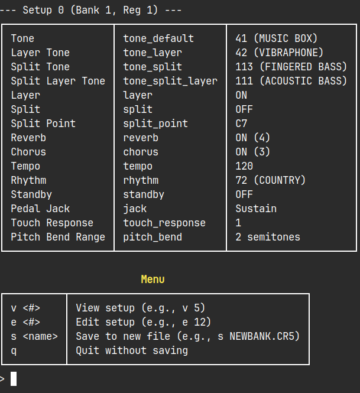

It's still a bit clunky, and I probably wouldn't release this as an actual program, but I've decided it's good enough. After all, there's barely any practical use to this program. Maybe I'll clean up the code a bit and put it on GitHub, and I'll update this post if I do so.

## What's Next?

Looking back at it now, the `.CR5` wasn't a particularly complex format to begin with, but it has nonetheless given me confidence to tackle the custom MIDI files. Since the Casio SMF Converter is a pretty small program (it's an early 2000s Win32 binary), I might even have a go at decompiling it.

However I'm not done with the `.CR5` format just yet. Since early on in the project, I wondered what would happen if I put invalid / out of range data in the file (eg. setting the tone to 800). Would the keyboard crash? Overflow or start over from 001? I've been experimenting with this recently and I've found some pretty interesting stuff, but that's a story for another day :)

!!! note ""
    I just realized I wrote this about an year ago, and I haven't made any real progress since then. Unfortunately I don't have access to the keyboard at the moment, however with the recent news about AI getting good at decompilation, I'm thinking about attempting to crack open the SMF converter. Hopefully soon?

[^1]: `file` is a command-line utility in Linux which is used to determine the type of a file.

[^2]: Most if not all file formats have a couple of byes at the beginning which are always the same for any file using that format. These bytes are called the 'file signature' or 'magic number', and can be used to identify / verify the format in case the file extension is incorrect or missing.
[^3]: Endianness is the order in which bytes of a multi-byte value are stored. [Endianness - Wikipedia](https://en.wikipedia.org/wiki/Endianness)
[^4]: Many keyboards have pressure-sensitive keys, so the sound they make is influenced by how hard you press them. A soft touch produces a quiet mellow sound, while pressing them harder produces a bright loud tone, similar to a real piano.
