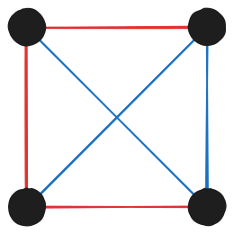

A while ago I was listening to [this episode](https://www.youtube.com/watch?v=Lq52irnwDNQ) of **The Rest is Science**[^1] about huge numbers, when the topic of Graham's number came up. This is an unimaginably large number defined by a mathematician named Ronald Graham in response to a mathematical problem. Hannah explained the absurdity of the number beautifully, but dumbed it down significantly, which is totally reasonable for a casual podcast. I was immediately intrigued by this topic so I did some research of my own, and I therefore present to you, *the absolute insanity of Graham's number*.

Graham's number is not "the biggest number" by any means, popularly being overshadowed by TREE(3) and Rayo's number. But Graham's number is still my favourite for two reasons. Firstly, it can be calculated by hand using just multiplication[^2]. Secondly, we can build it up from smaller and smaller numbers, so it's much easier to understand and appreciate the enormity of.

## The question

Graham's number is connected to a problem in a branch of mathematics called combinatorics (dealing with counting, permutations and the like). More specifically, it's a problem from Ramsey theory, a field of combinatorics which typically asks questions of the following format (I've stolen this from Wikipedia):

!!! info ""
    How big must some structure be to guarantee that a particular property holds?

Graham's number is the solution to the following problem (we'll break it down shortly).

!!! info ""
    Connect each pair of geometric vertices of an $`n`$-dimensional hypercube to obtain a complete graph on $`2^n`$ vertices. Colour each of the edges of this graph either red or blue. What is the smallest value of $`n`$ for which every such colouring contains at least one single-coloured complete subgraph on four coplanar vertices?
    
A hypercube is the evolution of a square in higher dimensions. Imagine a square with all vertices joined by lines, coloured red or blue at random. 

<div style="display: flex; justify-content: center">
    
</div>

The square has four edges and two diagonals, for a total of 6 lines. Can you find four coplanar vertices such that all lines connecting those vertices have the same colour? Well we only have four vertices to work with, all of them are coplanar since we're in two dimensions, and the edges are assigned one of the two colours at random. Of course there's no guarantee that all lines will have the same colour. So our answer is no.
    
Let's move up to three dimensions, i.e. a cube. We now have 12 edges, 12 face diagonals (2 on each of its 6 faces), and 4 space diagonals (connecting opposite corners of the cube) - a total of 28 lines to play with. We assign each of these one of the two colours arbitrarily, and ask the same question. "Can we find four coplanar vertices such that all lines connecting those vertices have the same colour?" In this example, we do have a square that obeys this rule, but this won't always be the case, so once again our answer is no.

The original problem asks what's the smallest dimension you need to get to, before it is inevitable that you will always find four coplanar vertices with all edges having the same colour, even if the colours were initially chosen at random.

Ronald Graham posited that the answer to this problem was above 6 and below a number he defined, called Graham's number. To even be able to read this number, we first need to learn a new mathematical symbol.

## A primer on Knuth's up-arrow notation

Because Graham's number is so big, it's impossible to represent it using regular algebraic symbols in a reasonable amount of time or space. It is instead represented using a special notation called an up-arrow ($`\uparrow`$), introduced by the computer scientist Donald Knuth in 1976.

Let's start simple. A single $`\uparrow`$ represents exponentiation. So for example,

```math
3 \uparrow 5 = 3^5 = 3 \times 3 \times 3 \times 3 \times 3 = 243
```

So far so good. Like most operators, you can have multiple $`\uparrow`$s in an expression, which are evaluated from right to left.

```math
4 \uparrow 3 \uparrow 3 = 4 \uparrow (3 \uparrow 3) = 4 \uparrow (3^3) = 4^{27} = 18,014,398,509,481,984
```

The interesting part about this notation is that you can chain multiple $`\uparrow`$s together, which escalates things rapidly.

!!! note ""
    $`\uparrow`$ represents repeated multiplication, i.e. exponentiation. $`x \uparrow y = x^y = \underbrace{x \times x \times \ldots \times x}_{\text{y times}}`$


!!! note ""
    $`\uparrow \uparrow`$ represents repeated exponentiation, i.e. tetration. $`x \uparrow \uparrow y = \underbrace{x^{x^{x^x\ldots}}}_{\text{y times}}`$


It's possible to break down the $`\uparrow \uparrow`$ into a series of $`\uparrow`$s, which I'll demonstrate with an example.

```math
3 \uparrow \uparrow 4 = 3 \uparrow (3 \uparrow \uparrow 3) = 3 \uparrow (3 \uparrow (3 \uparrow \uparrow 2)) = 3 \uparrow (3 \uparrow (3 \uparrow (3 \uparrow \uparrow 1)))
```

But $`3 \uparrow \uparrow 1`$ is just 3, like how $`3^1 = 3`$. So we end up with the following result.

```math
\ldots = 3 \uparrow (3 \uparrow (3 \uparrow 3)) = 3 \uparrow (3 \uparrow (3^3)) = 3 \uparrow (3 \uparrow 27) = 3 \uparrow (3^{27}) = 3 \uparrow 7,625,597,484,987 = 3^{7,625,597,484,987}
```

According to [Wolfram Alpha](https://www.wolframalpha.com/input?i=3%5E7625597484987), this number has 3,638,334,640,025 digits! You can see how repeated applications of the $`\uparrow`$ can blow things out of proportion rapidly.

!!! note ""
    $`\uparrow \uparrow \uparrow`$ represents repeated tetration, i.e. pentation. $`x \uparrow \uparrow \uparrow y = \underbrace{x \uparrow \uparrow (x \uparrow \uparrow (x \uparrow \uparrow (\ldots) ))}_{\text{y times}}`$

Here's an example.

```math
3 \uparrow \uparrow \uparrow 3 = 3 \uparrow \uparrow (3 \uparrow \uparrow \uparrow 2) = 3 \uparrow \uparrow 3 \uparrow \uparrow (3 \uparrow \uparrow \uparrow 1)
```

Just like the rest of the operations, $`x \uparrow \ldots \uparrow 1 = x`$, so we can simplify as follows.

```math
\ldots = 3 \uparrow \uparrow (3 \uparrow \uparrow 3) = 3 \uparrow \uparrow (3 \uparrow (3 \uparrow \uparrow 2)) = 3 \uparrow \uparrow (3 \uparrow (3 \uparrow 3)) = 3 \uparrow \uparrow 3^{3^3} = 3 \uparrow \uparrow 27
```

Now imagine $`3 \uparrow \uparrow 27`$ being broken down into a huge expression as we did with $`3 \uparrow \uparrow 4`$, and you end up with a power tower of 3s whose height is $`3^{27}`$.

```math
\underbrace{3^{3^{3^3 \dots}}}_{\text{7,625,597,484,987 times}}
```

If you recall the earlier example, $`3^{3^{3^3}}`$ i.e. $`3 \uparrow \uparrow 4`$ was a number with over 3 trillion digits. The scale of our new number is beyond human comprehension. Of course we could keep chaining together $`\uparrow`$s to get to newer hyperoperations like hexation & heptation, producing even more incomprehensible numbers.

Now that you understand the up-arrow notation, let's finally define Graham's number.

## Defining Graham's number

Graham starts by defining a number called $`g_1`$, with the value as follows.

```math
g_1 = 3 \uparrow \uparrow \uparrow \uparrow 3
```

This is already past the limits of human imagination. From the earlier example,

```math
3 \uparrow \uparrow \uparrow \uparrow 3 = \underbrace{3 \uparrow (3 \uparrow ( 3 \uparrow (\ldots)))}_{{\underbrace{3^{3^{3^3 \dots}}}_{\text{7,625,597,484,987 times}} times}}
```

As large as this number is, this isn't Graham's number. He instead goes on to define a second number, $`g_2`$ as follows.

```math
g_2 = 3 \underbrace{\uparrow \uparrow \ldots \uparrow \uparrow}_{g_1 \text{ } \uparrow \text{ arrows}} 3
```

Next comes $`g_3`$ with $`g_2`$ $`\uparrow`$ s between two 3s. Eventually we reach $`g_{64}`$

```math
g_{64} = 3 \underbrace{\uparrow \uparrow \ldots \uparrow \uparrow}_{g_{63} \text{ } \uparrow \text{ arrows}} 3
```

This is Graham's number, denoted by $`G`$.

```math
G = \left. \begin{matrix} 3\underbrace{\uparrow\uparrow\cdots\cdots\cdots\cdots\cdots\uparrow\uparrow}_{}3\\ 3\underbrace{\uparrow\uparrow\cdots\cdots\cdots\cdots\uparrow\uparrow}_{}3\\ \vdots\\
3\underbrace{\uparrow\uparrow\cdots\cdots\uparrow\uparrow}_{}3\\
3\uparrow\uparrow\uparrow\uparrow3 \end{matrix} \right\} \text{64 layers}
```

[^1]: An amazing [podcast](https://therestis.com/science) hosted by Michael Stevens and Hannah Fry.
[^2]: You just need an enormous amount of paper, ink, time and patience.
